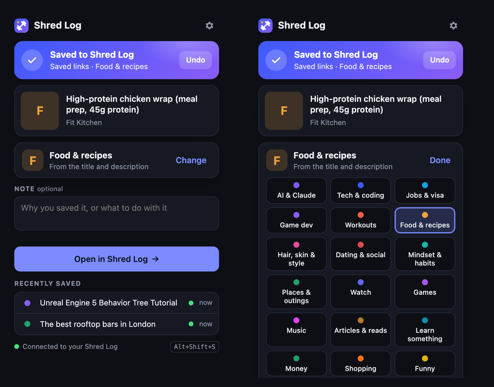

# Chrome extensions

Small Chrome extensions I build for my own workflow. Each folder is a standalone extension.

| Extension | What it does |
| --- | --- |
| [Shred Log Link Saver](shred-log) | One click or a right-click saves a page or link into my tracker app, sorted into a topic. YouTube videos go to a watch-later list |
| [YouTube Exact Summarizer](youtube-summarizer) | Summarises a YouTube video from its transcript into sorted notes with clickable timestamps |

## Trying one

1. Clone this repo.
2. Open `chrome://extensions` and turn on **Developer mode**.
3. Click **Load unpacked** and pick the extension's folder.

Each folder's README has the details.

`portfolio.json` feeds the extensions section on my [portfolio site](https://rahulchandraprogrammerportfolio.netlify.app).
