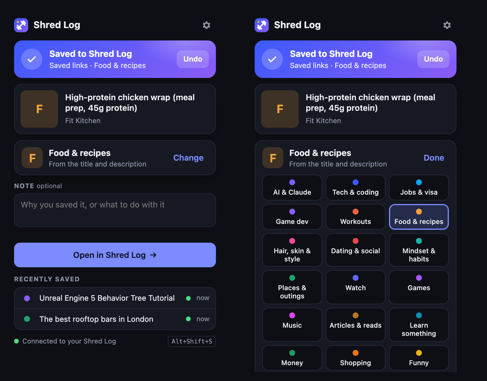

# Shred Log Link Saver

Shred Log is the tracker app I run my days from. It lives as a page on claude.ai. This extension gets links into it without copy and paste.

Click the toolbar button and the page you're on is saved. Right-click any link and it's saved without opening it. YouTube videos land in my Watch later list with the channel and length. Everything else goes to Saved links, already sorted into a topic like Workouts, Game dev or Jobs & visa.

## Install

1. Open `chrome://extensions` and switch on Developer mode.
2. Click Load unpacked and pick this folder.
3. Pin it from the puzzle piece menu in the toolbar.

You need to be signed in to claude.ai in the same Chrome. Links are written through the Shred Log page itself, so they sync like anything else in the app.

## Ways to save

- Toolbar button or `Alt+Shift+S` saves the page and opens a small popup. Wrong topic? Change it there, add a note, or undo.
- `Alt+Shift+D` saves without the popup.
- Right-click a link and pick "Send link to Shred Log".
- Drag a bookmark onto the "Shred Log inbox" folder on the bookmarks bar. It gets sent and pops back to where it was. Drop a whole folder on it and every link inside goes.
- Click the star in the address bar and file the page under "Shred Log inbox". Same thing, and no stray bookmark is left behind.

Chrome won't let extensions add items to the bookmarks bar's own right-click menu. That's why the inbox folder exists.

If Shred Log isn't open, the extension opens it in a pinned background tab and hands the links over. Anything waiting shows as a count on the toolbar badge.

## How sorting works

No AI here. `classify.js` scores each link on its domain (bbcgoodfood.com is food, greenhouse.io is a job post), then on words in the title and description. Your own rules in Settings run first, so `hitmarker.net` can always go to Jobs & visa.

## Files

- `background.js` handles the queue, delivery, the right-click menu, the bookmarks inbox and shortcuts
- `bridge.js` only wakes up inside the Shred Log page and passes messages in and out
- `classify.js` is the topic sorter
- `popup.*` and `options.*` are the UI
