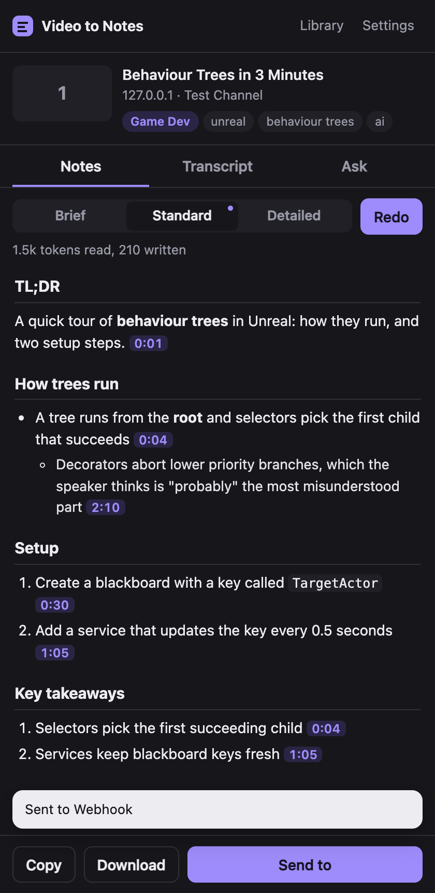
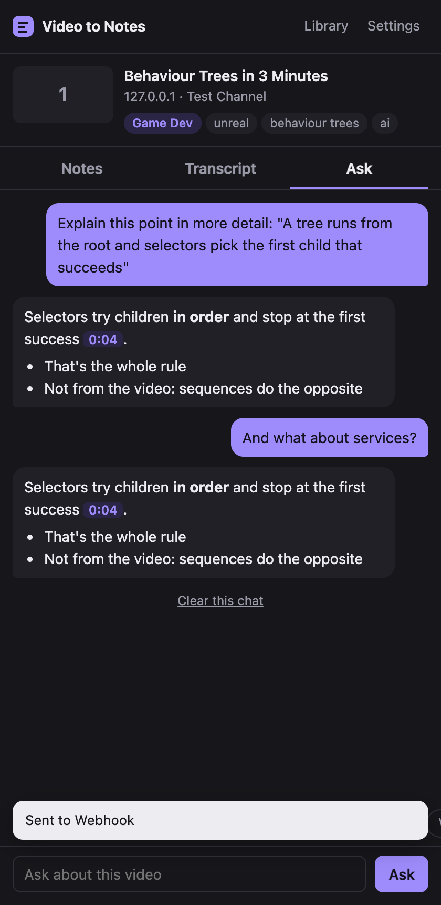

# Video to Notes

A Chrome side panel that turns the video you're watching into organised notes. It reads the captions, sends them to Claude, and gives you sections, bullet points and numbered steps, each with a timestamp you can click to jump there.

 

## What it does

- Notes in three lengths. Brief is a TL;DR and the key points. Standard sorts the video into sections. Detailed is full study notes with an outline, key terms and action items.
- Every video gets a category and a few tags, so the library can be filtered.
- A Transcript tab with search, click to seek, and a highlight that follows playback. Download it as .txt or .srt.
- An Ask tab for questions about the video. Hover any point in the notes and press the ? to have it explained.
- Notes are saved locally, so opening the same video again costs nothing.
- Send notes to Notion, a Markdown or text file, Obsidian, a webhook, or another extension. Any of these can run automatically when notes finish.

## Where it works

| Site | How captions are read |
| --- | --- |
| YouTube | The video's transcript, manual or auto-generated |
| Vimeo | The caption tracks in the player config |
| Any page with an HTML5 video | `<track>` caption files, or the cues the player has loaded |
| Twitch and anything without captions | Nothing to read. Paste a transcript or load a .vtt/.srt file instead |

It can't listen to audio. If a video has no captions anywhere, the extension has nothing to work from.

## Install

1. Open `chrome://extensions` and turn on Developer mode.
2. Click Load unpacked and pick this `youtube-summarizer` folder.
3. Click the toolbar icon to open the panel, go to Settings, and paste an Anthropic API key from console.anthropic.com.
4. Open a video and press Make notes. On YouTube there's also a button above the recommendations.

Alt+Shift+N opens the panel. Browsers without Chrome's side panel get a small window instead.

## Settings worth knowing

- Model: Opus 5.5 by default. Sonnet 5.5 and Haiku 5.5 are cheaper and faster.
- Notion needs an internal integration token and a link to a page or database you've shared with that integration. A database gets its Category, Tags, Channel and URL columns filled in when they exist.
- The webhook gets a JSON POST with the title, url, channel, category, tags, markdown and plain text.

## Privacy

The API key and all notes stay in `chrome.storage.local`. Transcripts go to `api.anthropic.com` and nowhere else, unless you send notes to a destination you set up. Nothing runs on a page until you open the panel, apart from the small button on YouTube.

## How it's put together

- `extract.js` is injected into the tab when the panel opens. It finds the video and reads captions.
- `lib/captions.js` parses WebVTT, SRT, TTML and YouTube's json3.
- `lib/claude.js` streams from the Messages API with plain `fetch`. The transcript is sent as a cached block, so follow-up questions reuse it.
- `lib/markdown.js` renders notes and converts them to Notion blocks.
- `lib/out.js` holds the export destinations.
- `panel.js` is the UI.

No build step and no dependencies.

Built with Claude Code. `NOTES-AI.md` lists what went wrong along the way and how it was caught.
